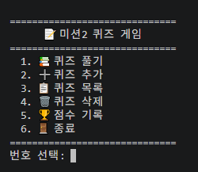
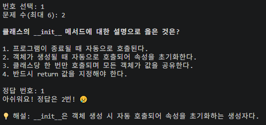
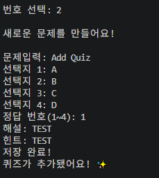
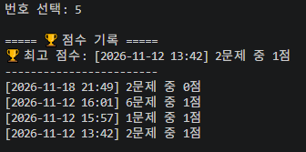

# 🎯 미션2 콘솔 퀴즈 게임

터미널에서 동작하는 **나만의 퀴즈 게임**입니다.
Python 기본 문법과 클래스(객체 지향), JSON 파일 저장, Git/GitHub 워크플로우를 처음부터 끝까지 직접 구현하며 익히는 것을 목표로 만들었습니다.

---

## 1. 프로젝트 개요

- 메뉴에서 번호를 선택해 **퀴즈 풀기 / 추가 / 목록 / 삭제 / 점수 기록 / 종료**를 할 수 있는 콘솔 프로그램입니다.
- `Quiz`, `QuizGame` 두 개의 클래스로 역할을 나누어 구성했습니다.
- 추가한 퀴즈, 최고 점수, 게임 기록은 `state.json`에 **UTF-8**로 저장되어 프로그램을 종료했다 다시 실행해도 유지됩니다.
- 외부 라이브러리 없이 **표준 라이브러리**(`json`, `random`, `datetime`)만 사용했습니다.

## 2. 퀴즈 주제와 선정 이유

**주제: Python 기초 등 (이번 미션의 학습 내용)**

- 이 미션의 학습 목표(자료형, 클래스, `__init__`/`self`, JSON 저장, `try/except`)를 퀴즈로 만들면 **문제를 만드는 과정 자체가 복습**이 된다고 생각했습니다.
- 게임을 플레이할 때마다 "왜 이렇게 동작하는지"를 다시 설명해 보게 되고, 해설(explanation)을 함께 작성하면서 개념을 내 말로 정리할 수 있습니다.
- 기본 퀴즈 5개는 모두 이 주제로 작성했습니다.

## 3. 실행 방법

### 요구 사항
- Python **3.10 이상**
- 외부 라이브러리 설치 불필요

### 실행
```bash
git clone https://github.com/a94496230-pixel/mission-1-2
cd mission-1-2
python quiz_mission.py
```

> macOS/Linux에서 `python` 명령이 없다면 `python3 quiz_mission.py`로 실행하세요.
> `state.json`은 **프로그램을 실행한 위치**에 생성되므로, 프로젝트 폴더 안에서 실행하는 것을 권장합니다.

## 4. 기능 목록

| 메뉴 | 기능 | 설명 |
|---|---|---|
| 1 | 📚 퀴즈 풀기 | 풀고 싶은 문제 수를 고르면 문제 순서를 **랜덤**으로 섞어 출제합니다. 정답/오답과 해설을 알려주고, 마지막에 점수를 보여줍니다. |
| 2 | ➕ 퀴즈 추가 | 문제, 선택지 4개, 정답 번호(1~4), 해설, 힌트를 입력받아 등록하고 즉시 `state.json`에 저장합니다. |
| 3 | 📋 퀴즈 목록 | 기본 퀴즈 + 추가한 퀴즈를 모두 보여줍니다. |
| 4 | 🗑️ 퀴즈 삭제 | **추가한 퀴즈**를 번호로 선택해 삭제하고 파일에 반영합니다. (기본 퀴즈는 삭제되지 않습니다.) |
| 5 | 🏆 점수 기록 | 최고 점수와 모든 게임 기록(날짜·푼 문제 수·점수)을 최신순으로 보여줍니다. |
| 6 | 🚪 종료 | 프로그램을 종료합니다. |

### 점수 규칙
- 정답: **1점**
- 힌트를 보고 맞힌 경우: **0.5점** (힌트 사용 시 감점)
- 오답: 0점
- 게임이 끝날 때마다 최고 점수와 비교해 갱신하고, 기록(history)에 추가합니다.

### 입력 · 예외 처리
- 숫자 입력(`input_number`): 앞뒤 공백 제거 → 빈 입력 / 숫자가 아닌 입력(`abc`) / 범위 밖 숫자(`9`, `0`)이면 안내 메시지 후 **다시 입력**받습니다.
- `Ctrl+C`(`KeyboardInterrupt`) 또는 입력 종료(`EOFError`)가 발생해도 비정상 종료하지 않고 **저장 후 안전하게 종료**합니다.
- `state.json`이 없으면(첫 실행) 기본 퀴즈로 시작합니다.
- `state.json`이 손상되었으면 안내 메시지를 출력하고 기본 퀴즈로 복구합니다.

### 보너스 과제 구현 현황
- [x] 랜덤 출제 (`random.shuffle`)
- [x] 문제 수 선택
- [x] 힌트 기능 + 힌트 사용 시 점수 차감
- [x] 퀴즈 삭제 기능
- [x] 점수 기록 히스토리 (날짜/시간, 푼 문제 수, 점수)

## 5. 실행 화면

| 메뉴 | 퀴즈 풀기 |
|---|---|
|  |  |

| 퀴즈 추가 | 점수 기록 |
|---|---|
|  |  |

## 6. 파일 구조

```text
.
├── quiz_mission.py        # 프로그램 전체 코드 (Quiz, QuizGame 클래스)
├── state.json             # 퀴즈·최고 점수·기록 저장 파일 (실행 후 자동 생성)
├── README.md              # 프로젝트 설명서
├── .gitignore             # Git 추적 제외 목록
└── docs/
    └── screenshots/       # 실행 화면 캡처 이미지
        ├── menu.png
        ├── play.png
        ├── add_quiz.png
        └── score.png
```

### 코드 구성 (`quiz_mission.py`)

| 이름 | 종류 | 역할 |
|---|---|---|
| `clean(text)` | 함수 | 입력 문자열의 인코딩 문제 문자를 제거 |
| `input_number(prompt, low, high)` | 함수 | `low`~`high` 범위의 숫자를 올바르게 입력받을 때까지 반복 |
| `Quiz` | 클래스 | 퀴즈 1개 표현. 속성: `question`, `choices`, `answer`, `explanation`, `hint` / 메서드: `show()`, `ask()` |
| `QuizGame` | 클래스 | 게임 전체 관리. 속성: `quizzes`, `custom_quizzes`, `best_score`, `history` |
| `QuizGame.show_menu()` | 메서드 | 메뉴 출력 |
| `QuizGame.play_quiz()` | 메서드 | 퀴즈 출제 · 채점 · 최고 점수 갱신 · 기록 저장 |
| `QuizGame.show_list()` | 메서드 | 퀴즈 목록 출력 |
| `QuizGame.delete_quiz()` | 메서드 | 추가 퀴즈 삭제 |
| `QuizGame.show_history()` | 메서드 | 최고 점수와 게임 기록 출력 |
| `QuizGame.save_data()` / `load_data()` | 메서드 | `state.json` 저장 / 불러오기 (예외 처리 포함) |
| `QuizGame.run()` | 메서드 | 메뉴 반복 실행 및 종료 처리 |

## 7. 데이터 파일 설명 (`state.json`)

- **경로**: 프로젝트 루트 (`./state.json`)
- **인코딩**: UTF-8 (`ensure_ascii=False`로 한글을 그대로 저장)
- **역할**: 프로그램을 종료해도 **추가한 퀴즈 · 최고 점수 · 게임 기록**이 유지되도록 하는 저장소 (데이터 영속성)
- **생성/갱신 시점**: 퀴즈 추가·삭제, 게임 종료(점수 갱신), `Ctrl+C` 종료 시

### 스키마

| 키 | 타입 | 설명 |
|---|---|---|
| `best_score` | number | 최고 점수 |
| `history` | list | 게임 기록 목록 |
| `history[].date` | string | 플레이 일시 (`YYYY-MM-DD HH:MM`) |
| `history[].total` | number | 푼 문제 수 |
| `history[].score` | number | 획득 점수 |
| `quizzes` | list | **사용자가 추가한 퀴즈** 목록 (기본 퀴즈 5개는 코드에 내장되어 있어 저장하지 않음) |
| `quizzes[].question` | string | 문제 |
| `quizzes[].choices` | list[string] | 선택지 4개 |
| `quizzes[].answer` | number | 정답 번호 (1~4) |
| `quizzes[].explanation` | string | 해설 (선택, 없으면 `""`) |
| `quizzes[].hint` | string | 힌트 (선택, 없으면 `""`) |

### 예시

```json
{
  "best_score": 4.5,
  "history": [
    { "date": "2026-11-18 21:30", "total": 5, "score": 4.5 }
  ],
  "quizzes": [
    {
      "question": "Python의 창시자는?",
      "choices": ["Guido van Rossum", "Linus Torvalds", "Bjarne Stroustrup", "James Gosling"],
      "answer": 1,
      "explanation": "Python은 귀도 반 로썸이 만들었다.",
      "hint": "이름이 G로 시작해요."
    }
  ]
}
```

## 8. Git 작업 기록

- 기능 단위로 커밋했으며, 커밋 메시지는 미션 수행 과정에 맞춰 작성했습니다.
- `readme` README.md파일을 작성하고 `main`에 병합했습니다.
- 퀴즈게임 완성 후 저장소를 별도 디렉터리에 `clone`하고, 변경 → `commit` → `push` 한 내용을 기존 작업 디렉터리에서 `pull`로 가져와 반영을 확인했습니다.

```text
$ git log --oneline --graph
* 6c27e0c (HEAD -> readme, origin/main, origin/HEAD, main) README 작성 초안
* cdb630b 퀴즈게임 코드 학습하며 주석
* 8acb3d4 완성된 게임 검토, 학습 중
* b0a09c6 완성된 코드 구조 및 기능 분석
* 3aff079 간단한 오타 및 가독성 수정
* 4093639 문제 힌트 기능 추가
* 6a52604 점수 기록 기능 추가
* cbeb5f1 점수 기록 기능 추가 중. 미완성
* 24b1b85 문제 삭제 기능 업데이트
* a36b87b 문제 수 선택 기능 추가
* ffc9549 숫자를 입력하기 위한 strip() 등 예외조건의 while루프를 함수로 대체함
* 503c058 while루프를 함수로 대체 전 커밋.
* c371651 미션 요구내용 보완. strip(), except오류잡기 조건 등
* 3114653 퀴즈게임 가독성관련 업데이트
* edcb743 문제 추가 중 글자깨짐으로 인한 오류 수정
* 91b62b2 문제 해설 출력기능 추가
* 910a011 주제설정, 기본문제 5개 입력
* 1de7486 클래스 추가(2개), 문제 출시순서 무작위 추가
* 00fc9ee 완성된 게임에 클래스 추가 중
* 05caeb2 미션 퀴즈게임 틀 만들기
* cb99519 2번 문제까지
```


